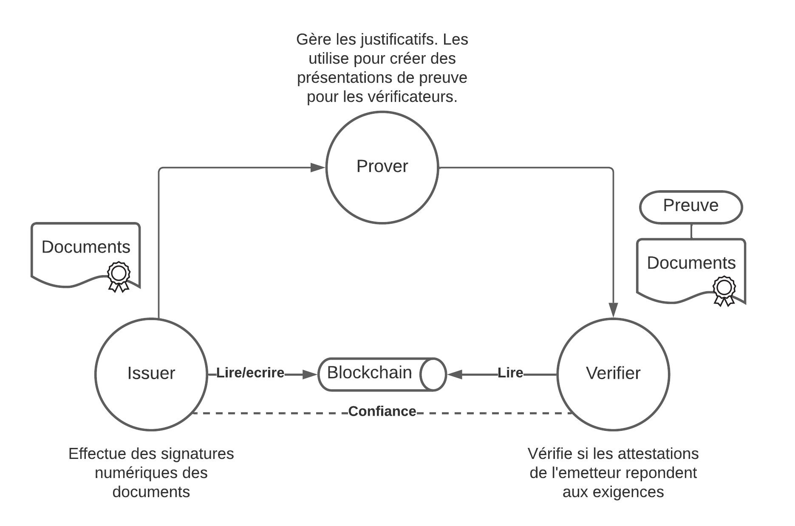
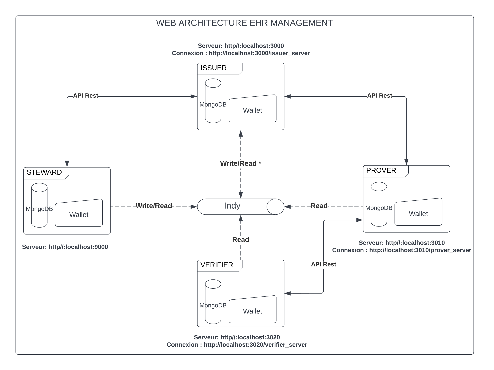

# **Système de gestion des dossiers de santé électroniques (EHR)**

### Version
* Branche releases 1.0.X [(première version)](https://github.com/mohamedberte/EHR_MANAGEMENT/tree/release/1.0.x)

## Objectif
Le système de gestion des dossiers de santé mis en place est une solution qui permet aux patients de garder un contrôle total sur leur identité et leurs informations de santé tout en facilitant l'accès à ces informations lorsqu'elles sont nécessaires.

## Acteurs
Le système de gestion des dossiers de santé implique trois acteurs, chacun ayant un rôle spécifique dans l'échange. Il y a le fournisseur de données, appelé **Issuer** (Émetteur), le donneur de preuves, appelé **Prover** (Preuveur), et le vérificateur de preuves, appelé **Verifier** (Vérificateur).



Les différents rôles au niveau de la blockchain Indy sont :
* **Trust Anchor** : L'entité responsable de la création et de la gestion des identités numériques sur la plateforme. Elle peut également être chargée de vérifier et certifier les informations d'identité des utilisateurs.
* **Steward** : L'entité qui gère et administre les identités numériques sur la plateforme. Elle peut aider les utilisateurs à créer leurs identités et à gérer leurs informations d'identité.
* **Monitor** : L'entité qui surveille l'utilisation de la plateforme et s'assure que toutes les transactions sont valides et conformes aux règles établies.
* **Endorser** : L'entité qui approuve les transactions et les mises à jour d'identité sur la plateforme. Elle garantit que toutes les transactions respectent les politiques de sécurité et de confidentialité.

## Architecture Web
L'architecture web utilise plusieurs technologies qui doivent être installées avant de pouvoir effectuer des manipulations. Elle se compose de quatre services :
- **Issuer** avec http://localhost:3000 et l'adresse de communication http://localhost:3000/issuer_server
- **Prover** avec http://localhost:3010 et l'adresse de communication http://localhost:3000/prover_server
- **Verifier** avec http://localhost:3020 et l'adresse de communication http://localhost:3000/verifier_server
- **Steward** avec http://localhost:9000



### Prérequis
* Python
* WSL avec une version d'Ubuntu ou directement sous Linux
* Réseau Indy lancé au préalable avec Docker [(Instructions)](https://github.com/TrustNetPK/indy-env-setup)
* Node.js version 8.x

### Étape 1
La première étape consiste à initialiser le réseau Indy. Si cela n'a pas encore été fait sur votre machine, vous devez suivre les instructions ci-dessous :

* Téléchargez et installez Docker [(Télécharger)](https://www.docker.com/)

* Clonez le projet Git sur votre machine : https://github.com/mohamedberte/EHR_MANAGEMENT/edit/main/README.md

* Ouvrez le terminal depuis votre dossier, puis exécutez la commande suivante pour passer en terminal Linux :
```console
wsl
```

* Ensuite, exécutez la commande suivante pour construire le réseau Indy sur Docker :

```console
npm run ledger:build
npm run ledger:start
```
* Pour l'arrêter, utilisez simplement cette commande :
```console
npm run ledger:stop
```


### Étape 2
Une fois le réseau Indy lancé, nous pouvons maintenant démarrer nos serveurs. Avant cela, nous devons installer les packages nécessaires pour lancer notre projet avec la commande suivante :

console
Copy code


```console
npm install
```
Ensuite, démarrez les services MongoDB avec :
```console
sudo service mongodb start
```
Et dans chaque terminal, lancez :
* For Steward :
```console
node nodes/app.js
```
* For Issuer :
```console
node issuer/app.js
```
* For Prover :
```console
node prover/app.js
```
* For Verifier :
```console
node verifier/app.js
```

## Demo video
The demonstration video is below
<object width="425" height="350">
  <param name="movie" value="#" />
  <param name="wmode" value="transparent" />
  <embed src="#"
         type="application/x-shockwave-flash"
         wmode="transparent" width="425" height="350" />
</object>
</hr>
